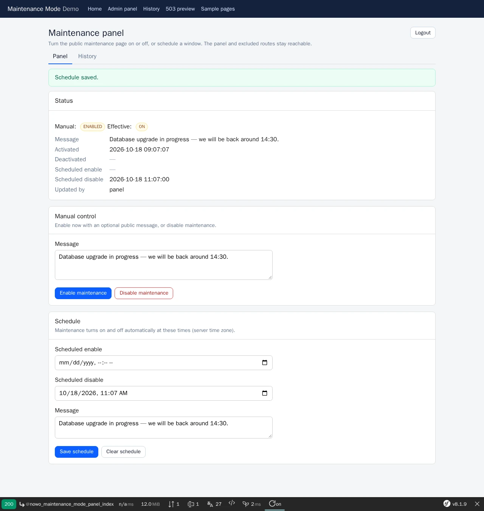
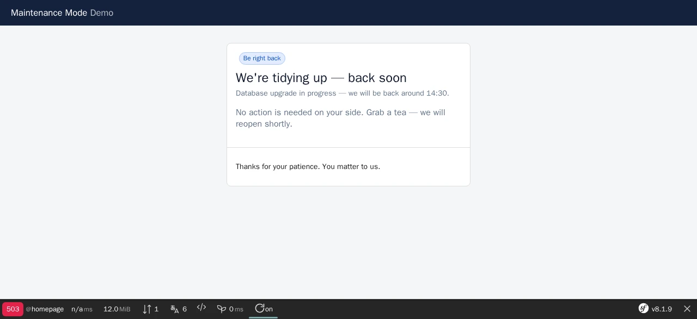
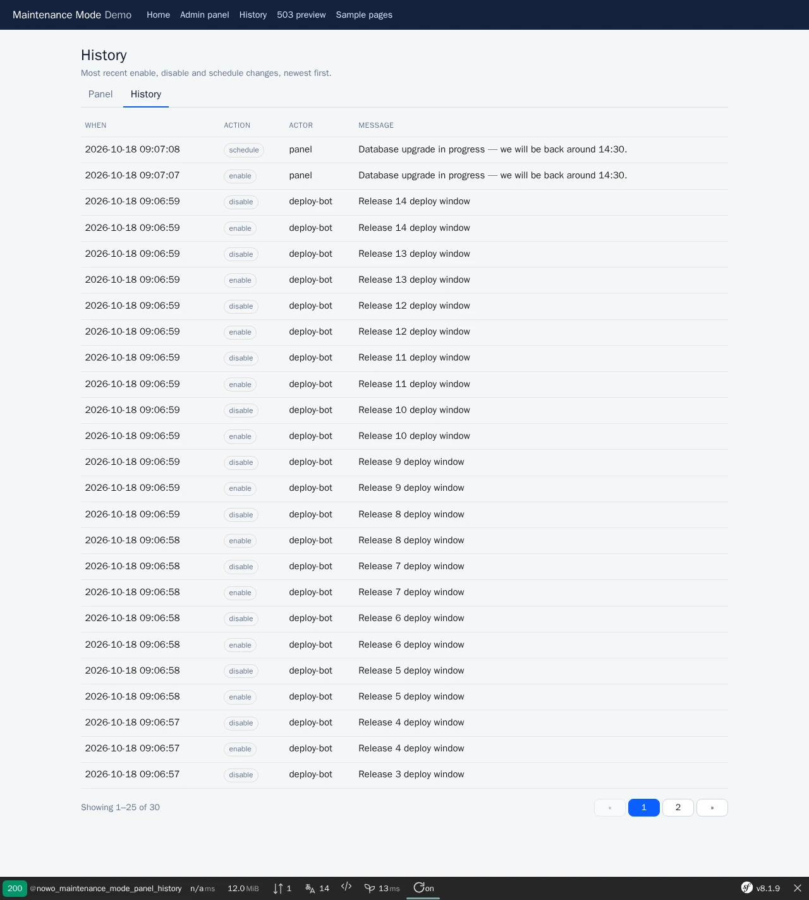

# Maintenance Mode Bundle

[](https://github.com/nowo-tech/MaintenanceModeBundle/actions/workflows/ci.yml) [](https://packagist.org/packages/nowo-tech/maintenance-mode-bundle) [](https://packagist.org/packages/nowo-tech/maintenance-mode-bundle) [](LICENSE) [](https://php.net) [](https://symfony.com) [](https://github.com/nowo-tech/MaintenanceModeBundle) [](#tests-and-coverage)

> ⭐ **Found this useful?** [Install from Packagist](https://packagist.org/packages/nowo-tech/maintenance-mode-bundle) · Give it a **star** on [GitHub](https://github.com/nowo-tech/MaintenanceModeBundle) so more developers can find it.

**Maintenance Mode Bundle** — Put a Symfony site into **maintenance mode** (HTTP **503**) with configurable exclusions, a Twig admin panel, scheduled windows, append-only history, and pluggable storage / access gates. Tested on Symfony **7.4**, **8.0**, and **8.1** · PHP 8.2+ (Symfony 8.x requires PHP 8.4+).


This bundle is **FrankenPHP worker mode friendly** — including when the kernel is **not** reset between requests (`reset_kernel false`). See [docs/FRANKENPHP-WORKER-AUDIT.md](docs/FRANKENPHP-WORKER-AUDIT.md).

<table>
  <tr>
    <td align="center" width="34%">
      
      <br><sub>Panel (<code>page/settings</code>)</sub>
    </td>
    <td align="center" width="33%">
      
      <br><sub>Public 503 (UiKit guest layout, no JS)</sub>
    </td>
    <td align="center" width="33%">
      
      <br><sub>History (<code>page/list</code>)</sub>
    </td>
  </tr>
</table>

Demo: `demo/symfony8` (FrankenPHP) — host layouts `templates/layouts/{admin,guest}.html.twig`, UiKit theme tokens, password `maintenance`. More: [login](docs/images/demo/login.webp) and [mobile 503](docs/images/demo/maintenance-page-mobile.webp) in [TEMPLATES.md](docs/TEMPLATES.md#screenshots).

## Features

- **503 listener** — Configurable-priority `kernel.request` interceptor (default after router), HTML or JSON, dynamic `Retry-After`, `Cache-Control: no-store`.
- **Exclusions** — Exact paths, prefixes, route names, globs, `#regex#` / `~regex~`, **IPs/CIDR**, `#[ExcludeFromMaintenance]`, soft bypass token.
- **Admin panel** — Enable / disable / schedule / clear schedule / history under a configurable prefix (default `/_maintenance`).
- **UiKit page contract** — Panel, history and login extend the UiKit 2.1 scaffolds (`page/settings`, `page/list`, `page/auth`); the public 503 renders on the UiKit guest layout with your theme tokens (no CDN, no JavaScript, no session). Theme once in `nowo_ui_kit.theme` ([TEMPLATES](docs/TEMPLATES.md)).
- **CLI** — `nowo:maintenance-mode:enable` (`--until`, `--message`, `--actor`), `nowo:maintenance-mode:disable`, `nowo:maintenance-mode:status`, `nowo:maintenance-mode:hash-password`.
- **Events & Twig** — Domain events on state changes; `nowo_maintenance_is_enabled()` / `nowo_maintenance_state()`.
- **Password gate** — Optional `password_hash` (bcrypt / argon2id); replaceable via `MaintenanceAccessGateInterface`.
- **Pluggable storage** — Filesystem JSON/JSONL by default; swap for Doctrine or anything else via DI.

## Installation

```bash
composer require nowo-tech/maintenance-mode-bundle
```

With **Symfony Flex**, the recipe registers the bundle and adds config. Without Flex, see [docs/INSTALLATION.md](docs/INSTALLATION.md).

```yaml
# config/routes.yaml
nowo_maintenance_mode:
    resource: '@NowoMaintenanceModeBundle/Resources/config/routes.yaml'
```

## Requirements

- PHP `>=8.2` (<8.6); **Symfony 8.0** and **8.1** require **PHP 8.4+**
- Symfony **7.4**, **8.0**, or **8.1** (`^7.4 || ^8.0`)
- Twig for the maintenance page and panel templates

## Configuration

```yaml
nowo_maintenance_mode:
    enabled: true
    default_message: "We're making a few gentle improvements. Everything you care about is safe."
    web_ui:
        path_prefix: '/_maintenance'
        layout_template: null          # null = nowo_ui_kit.layouts.admin
    security:
        password_protection: true
        password_hash: '%env(MAINTENANCE_PASSWORD_HASH)%'
        access_roles: [ROLE_ADMIN]
        # allow_unauthenticated: false
    exclusions:
        paths: ['/health']
        path_prefixes: ['/api/health']
```

## Usage

Open `/_maintenance` to toggle maintenance. Visitors hit the public page with **HTTP 503**; excluded routes and the panel keep working. In **dev**, preview the configured page at `/_maintenance_preview` (like `/_error/503`). Demo gallery: `/examples`.

```php
$maintenance->enable('Deploy in progress', 'ops');
$maintenance->disable('ops');
```

See [docs/USAGE.md](docs/USAGE.md).

## Demo

| Demo | Symfony | PHP | Default port |
| --- | --- | --- | --- |
| `demo/symfony8` | **8.1** | 8.5 | **8055** |

Runs **FrankenPHP + Caddy** (`FRANKENPHP_MODE=worker` by default). Panel password: `maintenance`. See [docs/DEMO-FRANKENPHP.md](docs/DEMO-FRANKENPHP.md).

```bash
make -C demo help
make -C demo up-symfony8
```

## Development

```bash
make up
make install
make test
make cs-check
make phpstan
make igor
make release-check
```

## Documentation

- [Installation](docs/INSTALLATION.md)
- [Configuration](docs/CONFIGURATION.md)
- [Usage](docs/USAGE.md)
- [Contributing](docs/CONTRIBUTING.md)
- [Code of Conduct](CODE_OF_CONDUCT.md)
- [Changelog](docs/CHANGELOG.md)
- [Upgrading](docs/UPGRADING.md)
- [Release](docs/RELEASE.md)
- [Security](docs/SECURITY.md)
- [Engram](docs/ENGRAM.md)
- [Spec-driven development](docs/SPEC-DRIVEN-DEVELOPMENT.md)
- [GitHub Spec Kit](docs/SPEC-KIT.md)

### Additional documentation

- [PSR evaluation (REQ-CS-007)](docs/PSR.md)
- [Demo (FrankenPHP)](docs/DEMO-FRANKENPHP.md)
- [FrankenPHP worker audit (`reset_kernel false`)](docs/FRANKENPHP-WORKER-AUDIT.md)
- [Maintenance page examples](docs/MAINTENANCE-PAGE-EXAMPLES.md)
- [GitHub Actions CI requirements](docs/GITHUB_CI.md)

## Tests and coverage

- Tests: PHPUnit (PHP)
- PHP: **100%** Lines (run `make coverage-check`)
- Justified exclusions (`@codeCoverageIgnore`, REQ-TEST-003): filesystem error branches of `FilesystemMaintenanceStateStorage` / `FilesystemMaintenanceHistoryStorage` (directory not creatable, write / rename / read failures that need a broken filesystem) and two defensive early returns in `MaintenanceModeExtension` (controller definitions that `services.yaml` always registers).

## License and author

MIT · [Nowo.tech](https://nowo.tech) · [Héctor Franco Aceituno](https://github.com/HecFranco)
